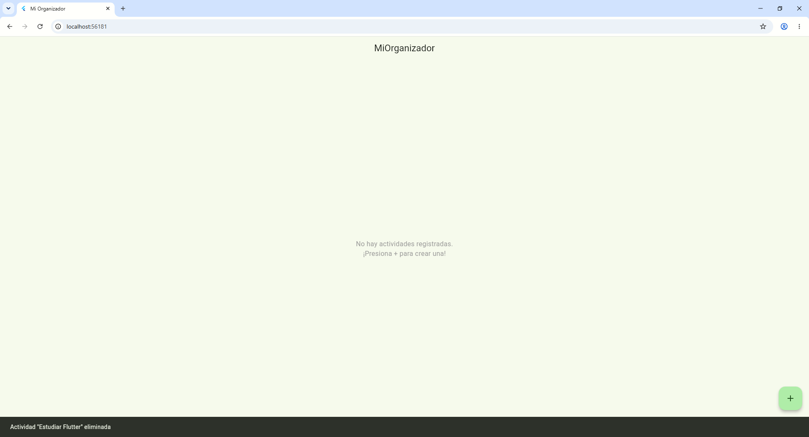
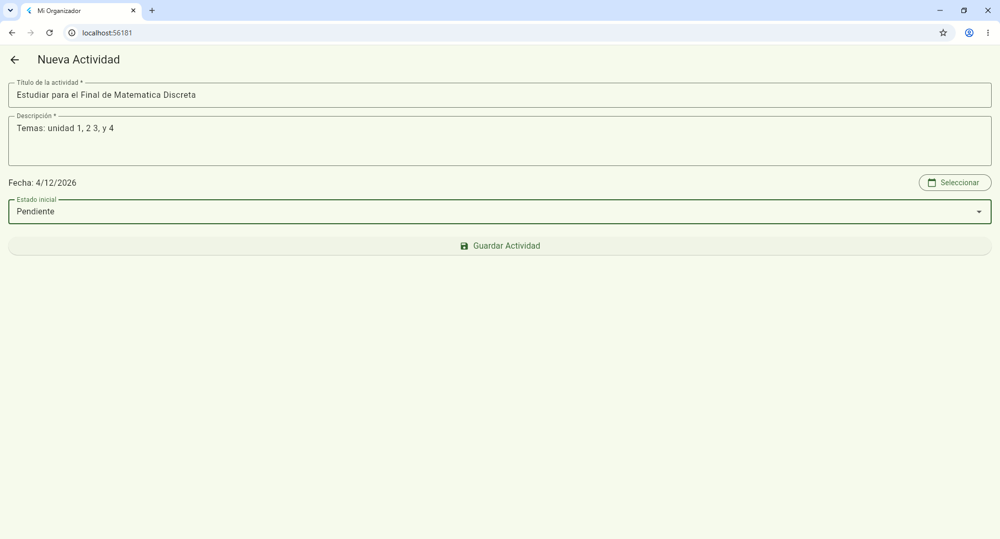
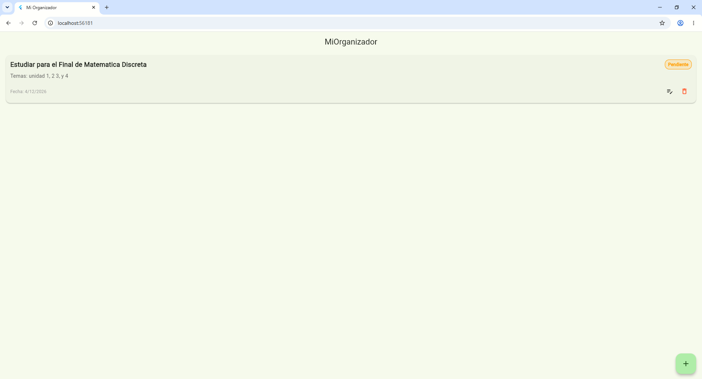
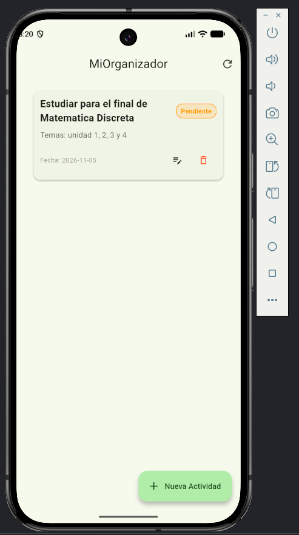

# MiOrganizador

App móvil de gestión de tareas desarrollada con Flutter y SQLite, como proyecto final de la materia Proyecto de Aplicaciones Móviles.








## Funcionalidades

- Crear, listar, editar y eliminar actividades (CRUD)
- Cada actividad tiene título, descripción, fecha y estado (`pending`, `inProgress`, `completed`)
- Los datos se guardan en el dispositivo y **persisten** al cerrar la app
- Navegación entre pantallas
- Interfaz con **Material Design 3**


## Tecnologías

| Área | Herramienta |
|---|---|
| Framework | Flutter (Dart) |
| Persistencia | SQLite (`sqflite`) |
| UI | Material Design 3 |
| Control de versiones | Git |

## Arquitectura

El proyecto está organizado por capas, con responsabilidades separadas:

```
lib/
├── config/          # Configuración de la app
├── core/            # Utilidades comunes
├── data/
│   ├── database/    # Acceso a SQLite
│   └── repositories/# Implementación concreta de los repositorios
├── domain/          # Entidades y contratos (repositorios abstractos)
├── presentation/    # Pantallas y widgets
├── shared/          # Componentes compartidos
├── app.dart
└── main.dart
```

## Decisiones de diseño:

- **Repository Pattern:** la interfaz `ActivityRepository` define las operaciones y `SQLiteActivityRepository` las implementa. La UI no conoce SQLite.
- **Principios SOLID:** responsabilidad única en cada clase e inversión de dependencias entre la UI y la persistencia.
- **Mapeo objeto-relacional manual:** `toMap()` y `fromMap()` convierten entre la entidad `Activity` y las filas de la tabla.

## Cómo ejecutarlo

Requisitos: [Flutter SDK](https://docs.flutter.dev/get-started/install) instalado (verificá con `flutter doctor`).

```bash
git clone https://github.com/Soffgonzzalez/miorganizador-flutter.git
cd miorganizador-flutter/mi_organizador
flutter pub get
flutter run
```

## Ramas

El desarrollo se organizó por sprints, integrando Gitlab:

| Rama | Contenido |
|---|---|
| `sprint1` | Creación del proyecto, arquitectura y buenas prácticas |
| `sprint2` | Interfaz, navegación y datos en memoria |
| `Sprint3` | Evolución de la app |
| `sprint4` | Persistencia local con SQLite y Repository Pattern |


## Autoría

Proyecto realizado en equipo para la materia *Proyecto de Aplicaciones Móviles*, CAECE, 2026.
